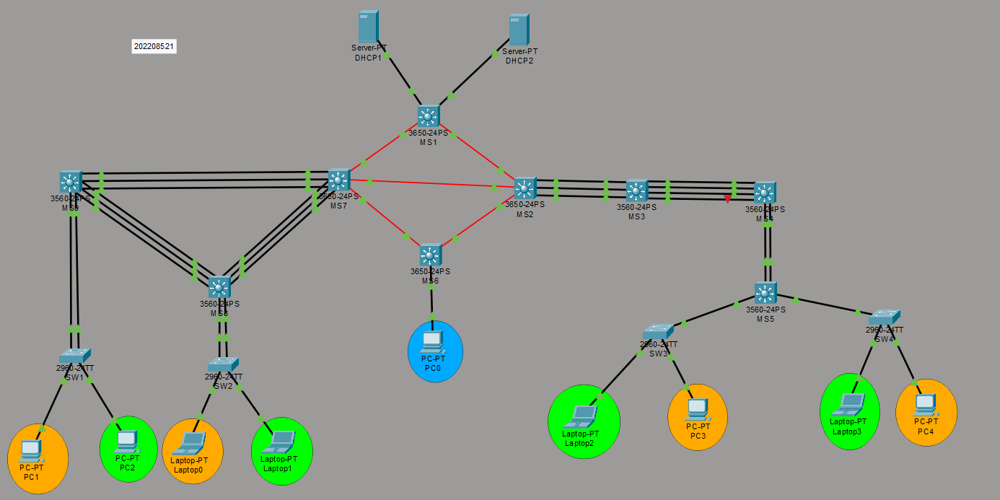

# Proyecto 1 — Chapin Red
**Redes de Computadoras 2 | Universidad San Carlos de Guatemala**  
**Facultad de Ingeniería | Ingeniería en Ciencias y Sistemas**  
**Estudiante:** Luis Rodrigo Morales Florián  
**Carné:** 202208521  
**Repositorio:** REDES2_1S2026_202208521

---

## Índice
1. [Descripción del Proyecto](#descripción-del-proyecto)
2. [Topología](#topología)
3. [Dispositivos utilizados](#dispositivos-utilizados)
4. [Diseño de Subnetting](#diseño-de-subnetting)
5. [VLANs y VTP](#vlans-y-vtp)
6. [EtherChannels](#etherchannels)
7. [Enrutamiento Dinámico EIGRP](#enrutamiento-dinámico-eigrp)
8. [Configuración DHCP](#configuración-dhcp)
9. [ACLs](#acls)
10. [STP](#stp)
11. [Comandos Principales](#comandos-principales)

---

## Descripción del Proyecto

Chapin Red es una empresa de responsabilidad social que opera desde múltiples edificios. Este proyecto implementa una red corporativa multi-edificio en Cisco Packet Tracer con:

- Arquitectura jerárquica de tres capas en el edificio izquierdo
- VLANs segmentadas por departamento
- Enlaces agregados con LACP y PAgP
- Enrutamiento dinámico con EIGRP
- Servidores DHCP centralizados con relay
- Políticas de seguridad con ACLs
- Protocolo STP para prevención de bucles

---

## Topología

La red está compuesta por 4 edificios interconectados mediante una Red MAN (Metropolitan Area Network):

- **Red MAN**: Switches multicapa Cisco 3650-24PS interconectados con fibra óptica (módulos GLC-LH-SMD, puertos Gi1/1/x)
- **Edificio Izquierdo**: Arquitectura jerárquica de 3 capas con LACP
- **Edificio Derecho**: Configuración con PAgP
- **Edificio Administración (MS6)**: Switch 3650 con PC0 (VLAN ADMIN)
- **Edificio Central (MS1)**: Switch 3650 con servidores DHCP

### Topología General



### Lista de Adyacencia
| Dispositivo | Conexiones |
|-------------|-----------|
| DHCP1, DHCP2 | MS1 (Gi1/0/1, Gi1/0/2) |
| MS1 | DHCP1, DHCP2, MS7 (Gi1/1/1), MS2 (Gi1/1/2) |
| MS7 | MS1 (Gi1/1/1), MS2 (Gi1/1/2), MS6 (Gi1/1/3), MS9 EC×3 (Po1), MS8 EC×3 (Po2) |
| MS2 | MS1 (Gi1/1/1), MS7 (Gi1/1/2), MS6 (Gi1/1/3), MS3 EC×3 (Po6) |
| MS6 | MS7 (Gi1/1/1), MS2 (Gi1/1/2), PC0 (Gi1/0/2) |
| MS9 | MS7 EC×3 (Po1), MS8 EC×3 (Po3), SW1 EC×2 (Po4) |
| MS8 | MS7 EC×3 (Po2), MS9 EC×3 (Po3), SW2 EC×2 (Po5) |
| MS3 | MS2 EC×3 (Po6), MS4 EC×4 (Po7) |
| MS4 | MS3 EC×4 (Po7), MS5 EC×2 (Po8) |
| MS5 | MS4 EC×2 (Po8), SW3, SW4 |
| SW1 | PC1 (Fa0/3), PC2 (Fa0/4), MS9 EC×2 (Po4) |
| SW2 | Laptop0 (Fa0/3), Laptop1 (Fa0/4), MS8 EC×2 (Po5) |
| SW3 | Laptop2 (Fa0/2), PC3 (Fa0/3), MS5 (Fa0/1) |
| SW4 | Laptop3 (Fa0/2), PC4 (Fa0/3), MS5 (Fa0/1) |

---

## Dispositivos Utilizados

| Dispositivo | Modelo | Cantidad |
|-------------|--------|----------|
| MS1, MS2, MS6, MS7 | Cisco 3650-24PS (Multilayer Switch) | 4 |
| MS9, MS8, MS3, MS4, MS5 | Cisco 3560-24PS (Multilayer Switch) | 5 |
| SW1, SW2, SW3, SW4 | Cisco 2960-24TT (Switch) | 4 |
| DHCP1, DHCP2 | Server-PT | 2 |
| PC0, PC1, PC2, PC3, PC4 | PC-PT | 5 |
| Laptop0, Laptop1, Laptop2, Laptop3 | Laptop-PT | 4 |

**Nota:** Los switches 3650-24PS tienen instalado el módulo **GLC-LH-SMD** para habilitar los puertos de fibra óptica Gi1/1/1 – Gi1/1/4.

---

## Diseño de Subnetting

### Redes Base
- `192.188.21.0/24` → VLANs de usuarios (FLSM /27)
- `10.4.21.0/24` → Enlaces de enrutamiento punto a punto (VLSM /30)

### Subnetting FLSM — VLANs de Usuarios (192.188.21.0/24 en /27)

| # | VLAN | Subred | Rango Útil | Broadcast | Gateway |
|---|------|--------|------------|-----------|---------|
| 1 | Naranja IZQ (VLAN 10) | 192.188.21.0/27 | .1 – .30 | .31 | .1 (MS9) |
| 2 | Verde IZQ (VLAN 20) | 192.188.21.32/27 | .33 – .62 | .63 | .33 (MS9) |
| 3 | Naranja DER (VLAN 30) | 192.188.21.64/27 | .65 – .94 | .95 | .65 (MS3) |
| 4 | Verde DER (VLAN 40) | 192.188.21.96/27 | .97 – .126 | .127 | .97 (MS3) |
| 5 | ADMIN (VLAN 99) | 192.188.21.128/27 | .129 – .158 | .159 | .134 (MS6) |
| 6 | DHCP1 (servidor) | 192.188.21.160/27 | .161 – .190 | .191 | .161 (MS1 Gi1/0/1) |
| 7 | DHCP2 (servidor) | 192.188.21.192/27 | .193 – .222 | .223 | .193 (MS1 Gi1/0/2) |

### Subnetting VLSM — Enlaces de Enrutamiento (10.4.21.0/24 en /30)

| Enlace | Subred /30 | IP Lado A | IP Lado B |
|--------|-----------|-----------|-----------|
| MS7 ↔ MS9 (Po1) | 10.4.21.0/30 | .1 (MS7) | .2 (MS9) |
| MS7 ↔ MS8 (Po2) | 10.4.21.4/30 | .5 (MS7) | .6 (MS8) |
| MS7 ↔ MS1 (Gi1/1/1) | 10.4.21.8/30 | .9 (MS7) | .10 (MS1) |
| MS7 ↔ MS2 (Gi1/1/2) | 10.4.21.12/30 | .13 (MS7) | .14 (MS2) |
| MS7 ↔ MS6 (Gi1/1/3) | 10.4.21.16/30 | .17 (MS7) | .18 (MS6) |
| MS1 ↔ MS2 (Gi1/1/2) | 10.4.21.20/30 | .21 (MS1) | .22 (MS2) |
| MS2 ↔ MS6 (Gi1/1/3) | 10.4.21.24/30 | .25 (MS2) | .26 (MS6) |
| MS2 ↔ MS3 (Po6) | 10.4.21.28/30 | .29 (MS2) | .30 (MS3) |

### IPs Estáticas Asignadas

| Dispositivo | Interfaz | IP | Propósito |
|-------------|----------|----|-----------|
| MS9 | Vlan10 | 192.188.21.1 | Gateway VLAN 10 |
| MS9 | Vlan20 | 192.188.21.33 | Gateway VLAN 20 |
| MS9 | Vlan99 | 192.188.21.129 | SVI ADMIN IZQ |
| MS8 | Vlan10 | 192.188.21.2 | SVI VLAN 10 |
| MS8 | Vlan20 | 192.188.21.34 | SVI VLAN 20 |
| MS3 | Vlan30 | 192.188.21.65 | Gateway VLAN 30 |
| MS3 | Vlan40 | 192.188.21.97 | Gateway VLAN 40 |
| MS3 | Vlan99 | 192.188.21.131 | SVI ADMIN DER |
| MS4 | Vlan30 | 192.188.21.66 | SVI VLAN 30 |
| MS4 | Vlan40 | 192.188.21.98 | SVI VLAN 40 |
| MS5 | Vlan30 | 192.188.21.67 | SVI VLAN 30 |
| MS5 | Vlan40 | 192.188.21.99 | SVI VLAN 40 |
| MS6 | Vlan99 | 192.188.21.134 | Gateway ADMIN |
| MS1 | Gi1/0/1 | 192.188.21.161 | Enlace DHCP1 |
| MS1 | Gi1/0/2 | 192.188.21.193 | Enlace DHCP2 |
| DHCP1 | Fa0 | 192.188.21.163 | Servidor DHCP IZQ |
| DHCP2 | Fa0 | 192.188.21.194 | Servidor DHCP DER |
| PC0 | Fa0 | 192.188.21.136 | ADMIN estática |

---

## VLANs y VTP

### Configuración VTP

| Dispositivo | Modo VTP | Rol |
|-------------|----------|-----|
| MS9 | Server | Crea y propaga VLANs edificio IZQ |
| MS3 | Server | Crea y propaga VLANs edificio DER |
| MS8, SW1, SW2 | Client | Aprenden VLANs del servidor IZQ |
| MS4, MS5, SW3, SW4 | Client | Aprenden VLANs del servidor DER |
| MS1, MS2, MS6, MS7 | Transparent | Dejan pasar anuncios VTP |

**Dominio VTP:** `ChapinRed`  
**Contraseña VTP:** `usac2021`  
**Versión VTP:** 2

### VLANs Definidas

| VLAN ID | Nombre | Edificio |
|---------|--------|----------|
| 10 | VLAN_Naranja_EdificioIZQ_202208521 | Izquierdo |
| 20 | VLAN_Verde_EdificioIZQ_202208521 | Izquierdo |
| 30 | VLAN_Naranja_EdificioDER_202208521 | Derecho |
| 40 | VLAN_Verde_EdificioDER_202208521 | Derecho |
| 99 | VLAN_ADMIN_202208521 | Global |

### Asignación de Puertos de Acceso

| Switch | Puerto | VLAN | Dispositivo |
|--------|--------|------|-------------|
| SW1 | Fa0/3 | 10 | PC1 |
| SW1 | Fa0/4 | 10 | PC2 |
| SW2 | Fa0/3 | 20 | Laptop0 |
| SW2 | Fa0/4 | 20 | Laptop1 |
| SW3 | Fa0/2 | 40 | Laptop2 |
| SW3 | Fa0/3 | 30 | PC3 |
| SW4 | Fa0/2 | 40 | Laptop3 |
| SW4 | Fa0/3 | 40 | PC4 |
| MS6 | Gi1/0/2 | 99 | PC0 |

---

## EtherChannels

### Resumen de Port-Channels

| Port-Channel | Protocolo | Dispositivo A | Puertos A | Dispositivo B | Puertos B | Canales | Capa |
|-------------|-----------|--------------|-----------|--------------|-----------|---------|------|
| Po1 | LACP | MS7 | Gi1/0/1-3 | MS9 | Fa0/1-3 | 3 | L3 |
| Po2 | LACP | MS7 | Gi1/0/4-6 | MS8 | Fa0/1-3 | 3 | L3 |
| Po3 | LACP | MS9 | Fa0/4-6 | MS8 | Fa0/4-6 | 3 | L2 |
| Po4 | LACP | MS9 | Fa0/7-8 | SW1 | Fa0/1-2 | 2 | L2 |
| Po5 | LACP | MS8 | Fa0/7-8 | SW2 | Fa0/1-2 | 2 | L2 |
| Po6 | LACP | MS2 | Gi1/0/1-3 | MS3 | Fa0/1-3 | 3 | L3 |
| Po7 | PAgP | MS3 | Fa0/4-7 | MS4 | Fa0/1-4 | 4 | L2 |
| Po8 | PAgP | MS4 | Fa0/5-6 | MS5 | Fa0/1-2 | 2 | L2 |


### Prueba de Tolerancia a Fallos

Se realizó prueba desconectando Fa0/1 de MS9 (miembro de Po1) mientras se ejecutaba `ping 192.188.21.68 repeat 1000` desde PC1. **Resultado: 0 paquetes perdidos** — el EtherChannel redistribuyó el tráfico entre los puertos restantes sin interrupción.

---

## Enrutamiento Dinámico EIGRP

**Protocolo:** EIGRP (carné impar 202208521)  
**AS Number:** 21

### Redes anunciadas por dispositivo

| Dispositivo | Redes en EIGRP |
|-------------|---------------|
| MS7 | 10.4.21.0/30, 10.4.21.4/30, 10.4.21.8/30, 10.4.21.12/30, 10.4.21.16/30 |
| MS1 | 10.4.21.8/30, 10.4.21.20/30, 192.188.21.128/27, 192.188.21.160/27, 192.188.21.192/27 |
| MS2 | 10.4.21.12/30, 10.4.21.20/30, 10.4.21.24/30, 10.4.21.28/30 |
| MS6 | 10.4.21.16/30, 10.4.21.24/30, 192.188.21.128/27 |
| MS9 | 10.4.21.0/30, 192.188.21.0/27, 192.188.21.32/27 |
| MS8 | 10.4.21.4/30, 192.188.21.0/27, 192.188.21.32/27 |
| MS3 | 10.4.21.28/30, 192.188.21.64/27, 192.188.21.96/27 |

**Nota:** MS4 y MS5 no tienen vecindad EIGRP directa ya que sus EtherChannels son capa 2. Utilizan rutas estáticas con default route hacia MS3 (`192.188.21.65`) y MS3 redistribuye la ruta estática hacia `192.188.21.128/27`.


### Comandos de verificación
```
show ip eigrp neighbors
show ip route
show ip eigrp topology
```

---

## Configuración DHCP

### Arquitectura DHCP

| Servidor | IP | Sirve a | Gateway relay |
|----------|-----|---------|---------------|
| DHCP1 | 192.188.21.163 | VLANs 10 y 20 (Edificio IZQ) | 192.188.21.161 (MS1 Gi1/0/1) |
| DHCP2 | 192.188.21.194 | VLANs 30 y 40 (Edificio DER) | 192.188.21.193 (MS1 Gi1/0/2) |

### Pools DHCP1 (Edificio IZQ)

| Pool | Red | Máscara | Gateway | Start IP |
|------|-----|---------|---------|----------|
| VLAN10 | 192.188.21.0 | 255.255.255.224 | 192.188.21.1 | 192.188.21.3 |
| VLAN20 | 192.188.21.32 | 255.255.255.224 | 192.188.21.33 | 192.188.21.35 |

### Pools DHCP2 (Edificio DER)

| Pool | Red | Máscara | Gateway | Start IP |
|------|-----|---------|---------|----------|
| VLAN30 | 192.188.21.64 | 255.255.255.224 | 192.188.21.65 | 192.188.21.68 |
| VLAN40 | 192.188.21.96 | 255.255.255.224 | 192.188.21.97 | 192.188.21.100 |

### DHCP Relay (ip helper-address)

Configurado en las SVIs de MS9 y MS8 (edificio IZQ) y MS3, MS4, MS5 (edificio DER):

```
interface vlan 10
 ip helper-address 192.188.21.163

interface vlan 20
 ip helper-address 192.188.21.163

interface vlan 30
 ip helper-address 192.188.21.194

interface vlan 40
 ip helper-address 192.188.21.194
```

---

## ACLs

### Políticas de Comunicación

| Origen | Destino | Acción |
|--------|---------|--------|
| VLAN Naranja (10/30) | VLAN Naranja (10/30) |  Permitido |
| VLAN Verde (20/40) | VLAN Verde (20/40) | Permitido |
| VLAN ADMIN (99) | Cualquier VLAN | Permitido |
| VLAN Naranja | VLAN Verde | Bloqueado |
| VLAN Naranja | VLAN ADMIN | Bloqueado |
| VLAN Verde | VLAN Naranja | Bloqueado |
| VLAN Verde | VLAN ADMIN | Bloqueado |
| Cualquier VLAN | VLAN ADMIN (inicio) | Bloqueado |

### ACL_NARANJA_IZQ (aplicada en MS9 Vlan10 inbound)

```
ip access-list extended ACL_NARANJA_IZQ
 deny icmp 192.188.21.0 0.0.0.31 192.188.21.128 0.0.0.31 echo
 deny icmp 192.188.21.0 0.0.0.31 192.188.21.32 0.0.0.31 echo
 deny icmp 192.188.21.0 0.0.0.31 192.188.21.96 0.0.0.31 echo
 permit ip any any
```

### ACL_VERDE_IZQ (aplicada en MS9 Vlan20 inbound)

```
ip access-list extended ACL_VERDE_IZQ
 deny icmp 192.188.21.32 0.0.0.31 192.188.21.128 0.0.0.31 echo
 deny icmp 192.188.21.32 0.0.0.31 192.188.21.0 0.0.0.31 echo
 deny icmp 192.188.21.32 0.0.0.31 192.188.21.64 0.0.0.31 echo
 permit ip any any
```

### ACL_NARANJA_DER (aplicada en MS3 Vlan30 inbound)

```
ip access-list extended ACL_NARANJA_DER
 deny icmp 192.188.21.64 0.0.0.31 192.188.21.128 0.0.0.31 echo
 deny icmp 192.188.21.64 0.0.0.31 192.188.21.32 0.0.0.31 echo
 deny icmp 192.188.21.64 0.0.0.31 192.188.21.96 0.0.0.31 echo
 permit ip any any
```

### ACL_VERDE_DER (aplicada en MS3 Vlan40 inbound)

```
ip access-list extended ACL_VERDE_DER
 deny icmp 192.188.21.96 0.0.0.31 192.188.21.128 0.0.0.31 echo
 deny icmp 192.188.21.96 0.0.0.31 192.188.21.0 0.0.0.31 echo
 deny icmp 192.188.21.96 0.0.0.31 192.188.21.64 0.0.0.31 echo
 permit ip any any
```
**Nota técnica:** Se utilizó `icmp echo` en lugar de `deny ip` para bloquear únicamente las solicitudes de ping, permitiendo que las respuestas pasen. Esto resuelve el problema de bloqueo bidireccional que ocurre cuando se deniega todo el tráfico IP.

---

## STP

**Modo:** PVST+ (Per-VLAN Spanning Tree)

| Root Bridge | VLANs |
|-------------|-------|
| MS9 | 10, 20, 99 (prioridad 4096 para VLAN 99) |
| MS3 | 30, 40 |

### Comandos de configuración
```
spanning-tree vlan 10 root primary   ! en MS9
spanning-tree vlan 20 root primary   ! en MS9
spanning-tree vlan 99 priority 4096  ! en MS9
spanning-tree vlan 30 root primary   ! en MS3
spanning-tree vlan 40 root primary   ! en MS3
spanning-tree vlan 99 priority 8192  ! en MS3
```

---

## Comandos Principales

### VTP
```
vtp mode server|client|transparent
vtp domain ChapinRed
vtp password usac2021
vtp version 2
show vtp status
show vlan brief
```

### EtherChannel LACP
```
interface range Fa0/1-3
 channel-group 1 mode active
interface port-channel 1
 switchport trunk encapsulation dot1q
 switchport mode trunk
show etherchannel summary
show interfaces trunk
```

### EtherChannel PAgP
```
interface range Fa0/4-7
 channel-group 7 mode desirable
interface port-channel 7
 switchport trunk encapsulation dot1q
 switchport mode trunk
show etherchannel summary
```

### EIGRP
```
router eigrp 21
 network 10.4.21.0 0.0.0.3
 no auto-summary
 passive-interface vlan 10
show ip eigrp neighbors
show ip route
show ip eigrp topology
```

### DHCP Relay
```
interface vlan 10
 ip helper-address 192.188.21.163
show ip interface vlan 10
```

### ACLs
```
ip access-list extended ACL_NARANJA_IZQ
 deny icmp 192.188.21.0 0.0.0.31 192.188.21.128 0.0.0.31 echo
 permit ip any any
interface vlan 10
 ip access-group ACL_NARANJA_IZQ in
show ip access-lists
```

### STP
```
spanning-tree mode pvst
spanning-tree vlan 10 root primary
show spanning-tree vlan 10
show spanning-tree summary
```

### Verificación General
```
show ip interface brief
show interfaces status
show cdp neighbors
show vlan brief
show etherchannel summary
show interfaces trunk
show ip route
show ip eigrp neighbors
show ip access-lists
show spanning-tree summary
```
